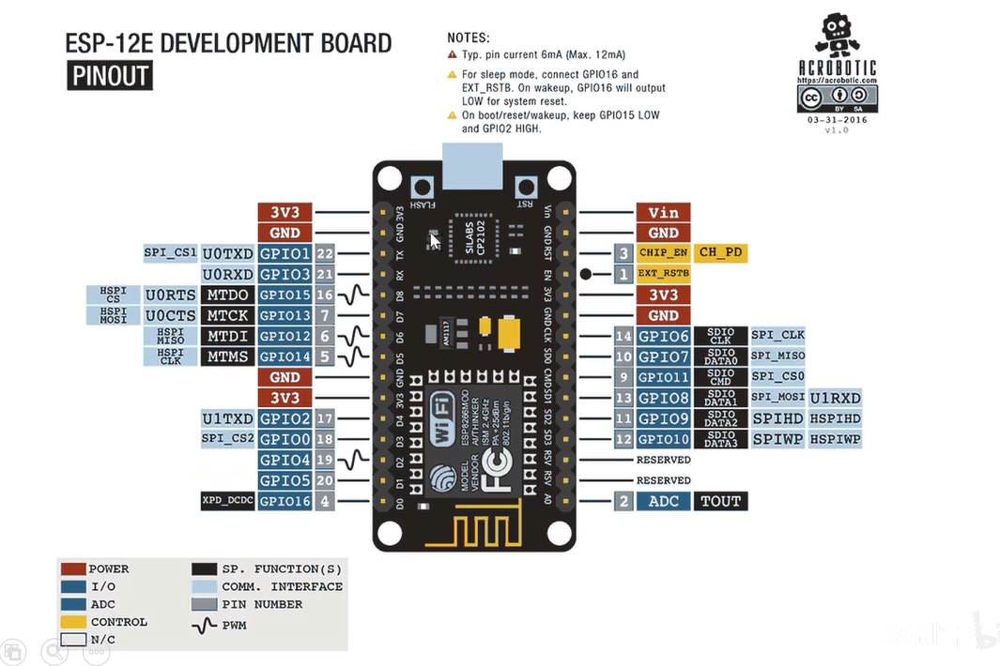
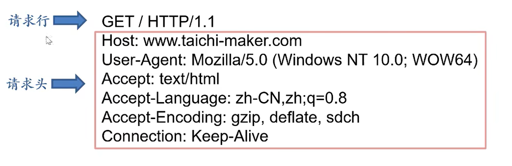
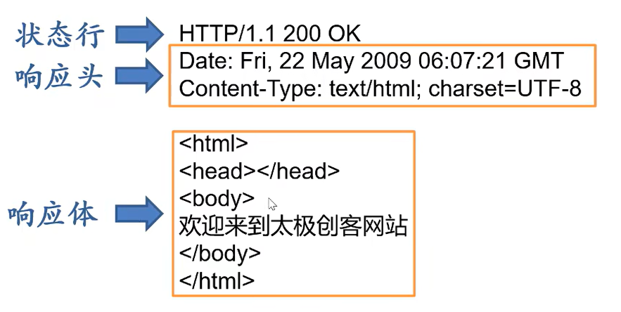

# 2-1开发板详解

## 开发板 ESP8266-NodeMCU



**GPIO**：通用输入输出。

**ADC**：模拟引脚。

**U(0/1)TXD/U(0/1)RXD**：输出、输入引脚。

**RET**：复位键。

蓝底白字：ESP-8266上的引脚

蓝底黑字：NodeMCU和其他设备通讯用的引脚。

黑底白字：NodeMCU存储单元的引脚。

灰底白字：其他引脚。

3V3：提供3.3v的引脚。


*注意：NodeMCU支持的数字引脚电压为3.3v，Arduino Uno R3支持的数字引脚电压为5v。*

*NodeMCU模拟引脚可读取电压范围为0-1v。*

# 2-2 互联网基础-1

**互连网(TCT/IP)协议**：互联网上所使用的通用协议称为互连网协议。

## ESP-8266利用WiFi联网的三种工作模式

1. 接入点模式（直接连接）
2. 无线终端模式（间接连接）
3. 混合模式

**网关**：连接网络与网络的关口。

**子网掩码**：限制ip地址中的数字哪些属于局域网，哪些属于设备。

# 2-3 互联网基础-2

## HTTP协议

组成：请求与响应

### HTTP请求格式



**请求行**：GET/HTTP/1.1

GET：读取请求。

POST：发送请求

HTTP/1.1：协议版本

**请求头**

Host：主机服务器

User-Agent：电脑信息

Accept：支持编程语言

Accept-Language：支持自然语言

Accept-Encodeing：支持压缩信息编码格式

Connection：连接状态

### HPPT响应格式



**状态行**

HTTP/1.1：协议版本

200 OK：状态码

**响应头**

Content-Type: 响应类型

txet/html：HTML网页代码

charset：字符集

# 3-1 ESP-8266物联网开发基础

## ping

### ping是什么？
Ping 是一个网络工具，用来测试两台设备之间能否通信以及通信质量如何。名字来源于声纳探测的"回声"——发出一个信号，听有没有回应。

### ping的工作原理
Ping 使用的是 ICMP 协议（Internet Control Message Protocol）。过程很简单：

1. 你的设备向目标 IP/域名发送一个 ICMP Echo Request（回声请求）包

2. 对方收到后，回一个 ICMP Echo Reply（回声应答）包

3. 你的设备记录发出到收到的时间（往返延迟，RTT）

如果对方没回应或超时，就说明"ping 不通"。

Node MCU 默认IP地址：192.168.4.1

## 代码实现

### 连入NodeMCU

```cpp
#include<ESPWiFi.h>//使用ESP8266WiFi库

const char *ssid = "taichi-maker";//自定义名称（ssid通俗的说就是wifi名）
const char *password = "12345678";//自定义密码,不需要可以不写

void setup()
{
    Serial.begin();
    WiFi.softAP(ssid, paseword);//作用：是让 ESP8266 自己变成一个 WiFi 热点（软接入点），让手机、电脑等设备能直接连上它

    Serial.print("Access Point: ");
    Serial.println(ssid);
    Serial.print("IP address: ");
    Serial.println(WiFi.softAPIP());//作用：查看 ESP8266 作为热点（AP 模式）时，它自己的 IP 地址是多少。默认情况下是192.168.4.1
}
void loop()
{
}
```

*注意：每次打开串口监视器都需要手动按下NodeMCU复位键*

### NodeMCU连入其他网络

```cpp
#include<ESP8266WiFi.h>

const char *ssid = "taichi-maker";//填写将要连入的网络名
const char *password = "12345678";//填写其密码

void setup()
{
    Serial.begin(9600);

    WiFi.begin(ssid,pasword);//启动网络连接
    Serial.print("Connecting to ");//串口监视器输出网络连接信息
    Serial.print(ssid);
    Serial.println("...");//告知用户正在尝试连接网络

    int i = 0;
    while(WiFi.status() != WL_CONNECTED)//用于判断是否断联
    {
        //打印等待时间
        delay(1000);
        Serial.print(i++);
        Serial.print(' ');
    }

    Serial.println("");
    Serial.println("Connection Established!");
    Serial.print("IP daaress: ");
    Serial.println(WiFi.localIP());//获取本地IP
}

void loop()
{
}
```

# 3-2 ESP8266网络服务器

```cpp
//调用函数库
#include<ESP8066WiFi.h>
#include<ESP8266WiFiMulti.h>
#include<ESP8266WebServer.h>

ESP8266WiFiMulti wifiMulti;

//括号中的数字是网络服务器响应http请求的端口
//网络服务器标准http端口是80
ESP8266WebServer esp8266_server(80);

void setup()
{
    Serial.begin(9600);
    wifiMulti.addAP("taichi-maker",)
}