# arduino学习日志

## 9.26

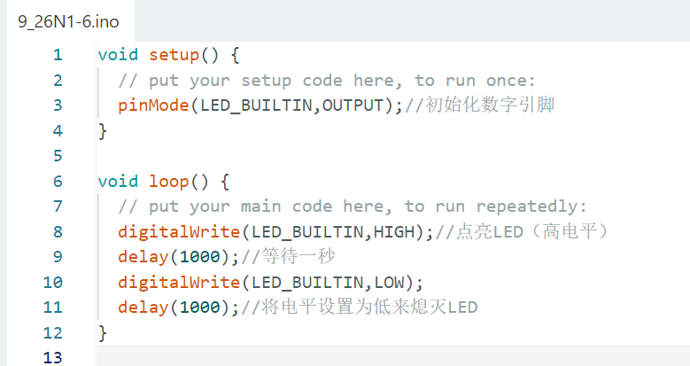

### 数字输入与输出

**pinMode(pin，mode)**

**作用**：在使用一个数字引脚之前，先告诉 Arduino 这个引脚是作为输入还是输出使用。

**参数**：

pin：引脚编号（如 2、LED_BUILTIN）。

mode：INPUT（输入）、OUTPUT（输出）、INPUT_PULLUP（输入并启用内部上拉电阻）。

**digitalWrite(pin，value)**

**作用**：让一个已配置为输出的引脚输出高电平或低电平，从而控制外部设备（如点亮 LED、驱动继电器）。

**参数**：

pin：引脚编号。

value：HIGH（高电平，通常 5V 或 3.3V）或 LOW（低电平，0V）。

**digitalRead(pin,value)**

**作用**：读取一个已配置为输入的引脚上的电平状态，返回 HIGH 或 LOW。常用于读取按钮、开关、传感器数字信号等。

**参数**：

pin：引脚编号。

返回值：HIGH 或 LOW。

### 数字输入

**Serial.begin(9600)**

**作用**：串口通讯初始化。一般是每秒9600。初始化之后才能使用Serial库里的函数。

### 其他名词

VCC：在数字电路中指代正电源电压

### 学习网站

在tinkercad上可以模拟使用arduino板，非常方便。

## 9.27

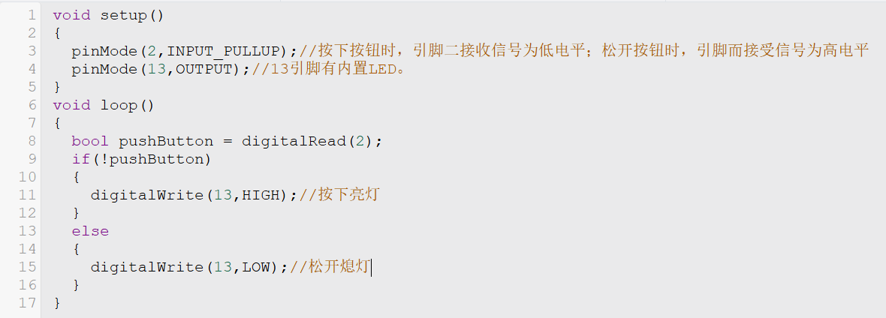

*加入逻辑或*

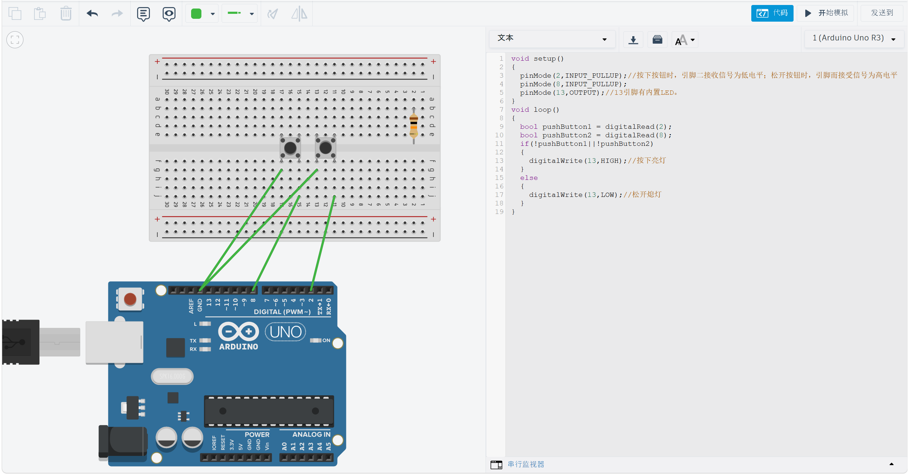

### 新元件-七段数码管

*如图*

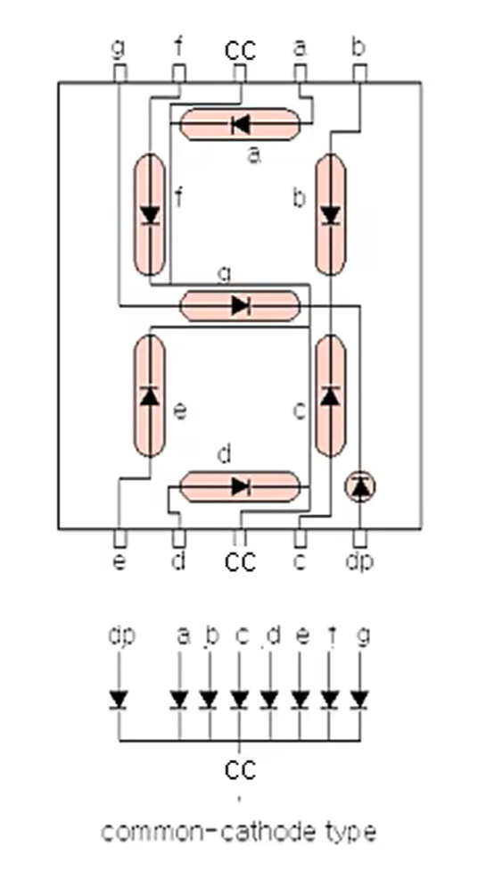

*日后学习中，每个端口都默认对应引脚*

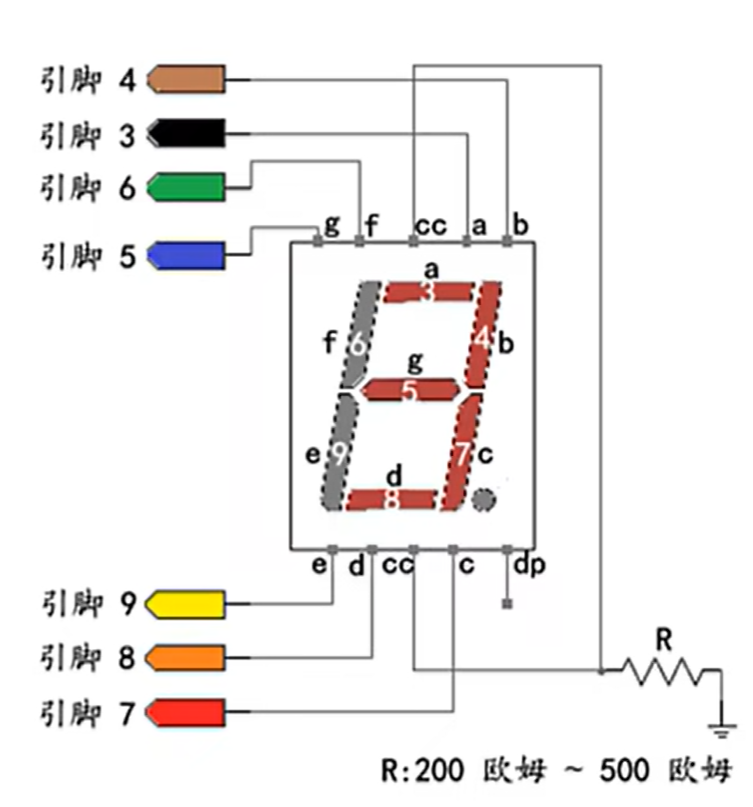

*特别备注：在tinkercad中，七段数码管的公脚设为阳极且连接5v时，低电平才会亮灯；设为阴极且连接GND时，高电平才会亮灯*

### 模拟输出1

**analogWrite(pin,value)**

**作用**：在支持 PWM 的引脚上输出一个方波，通过改变占空比来模拟不同的平均电压。

**参数**：

pin：支持 PWM 的引脚（Arduino UNO 上是 3、5、6、9、10、11，标有 ~ 符号）。

value：0～255。

0 → 占空比 0%，等效 0V（一直低）。

127 → 约 50%，等效约 2.5V。

255 → 占空比 100%，等效 5V（一直高）。
**作用**：在支持 PWM 的引脚上输出一个方波，通过改变占空比来模拟不同的平均电压。

**参数**：

pin：支持 PWM 的引脚（Arduino UNO 上是 3、5、6、9、10、11，标有 ~ 符号）。

value：0～255。

0 → 占空比 0%，等效 0V（一直低）。

127 → 约 50%，等效约 2.5V。

255 → 占空比 100%，等效 5V（一直高）。

*注意：在UNO开发版上仅支持3、5、6、9、10、11引脚进行模拟输出*

### 通过模拟电流大小控制LED亮度

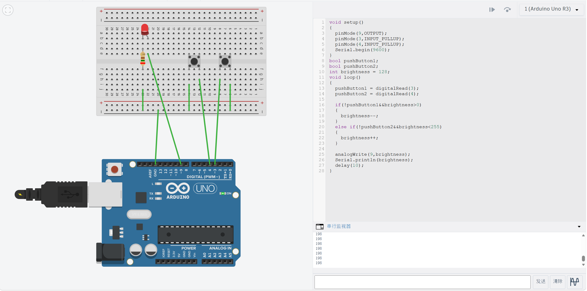

### 模拟输出2-PWM

**概念**

PWM（脉冲宽度调制）就是通过快速开关，用“高电平时间占整个周期的比例”（占空比）来等效地输出不同电压。开关足够快时，LED 看起来是不同亮度，电机看起来是不同转速。

其中,analogWrite函数就是输出PWM的函数，value就是占空比。

*注意：频率决定“开关多快”，占空比决定“开多久”。*

### 模拟输入1-电位器

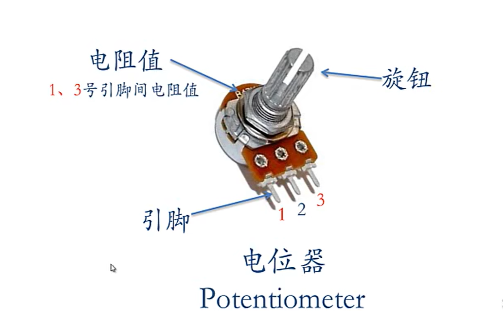

*注意：电位器旋钮往哪边转，哪边电阻减小，反方向的电阻增大*

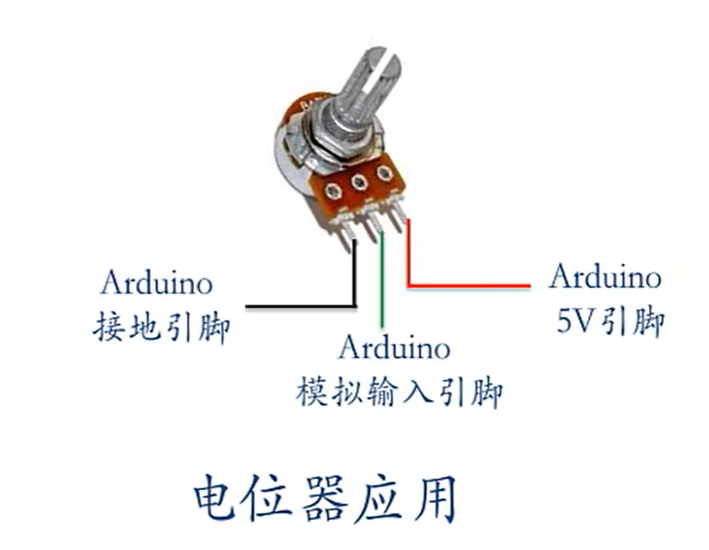

### 模拟输入2-analogRead()

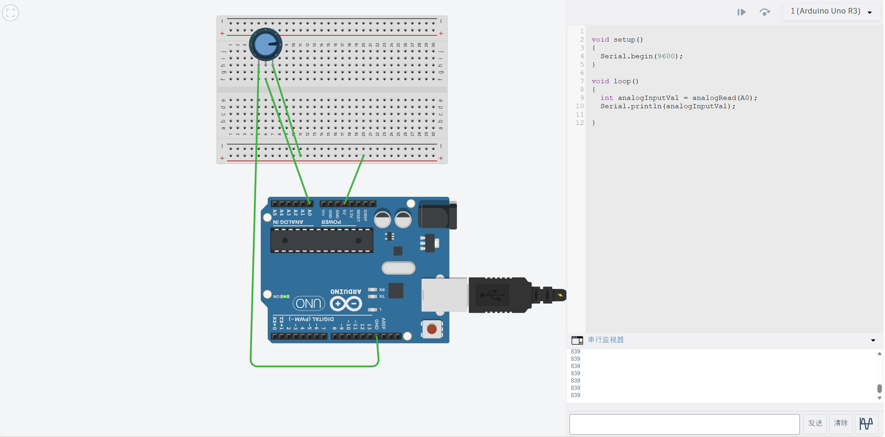

**analogRead()**
作用：读取一个analog引脚上的电平状态，返回0~1023之间的整数。
参数：pin

analogRead()使用时无需初始化。
其返回值的含义为：电压 = 返回值/1024*5（UNO默认电压为5v）

### 模拟输入3-用电位器调节LED亮度

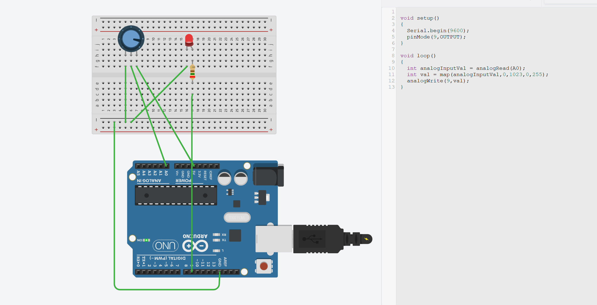

**map(value, fromLow, fromHigh, toLow, toHigh)**

**作用**：用来把一个数值从一个范围线性映射到另一个范围。

| 参数 | 含义 |
|------|------|
| value	| 要转换的原始值 |
| fromLow |	原始范围的下限 |
| fromHigh | 原始范围的上限 |
| toLow | 目标范围的下限 |
| toHigh | 目标范围的上限 |
| 返回值 | 映射后的新值 |

## 9.28

### 直流伺服电机

*工作流程*

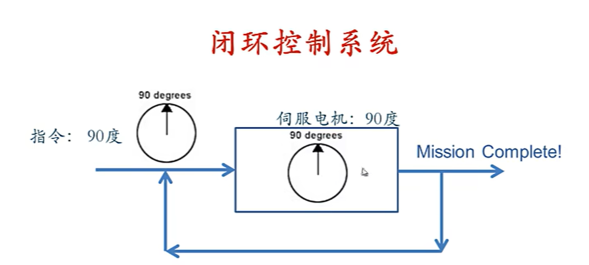

*主要组成部分*

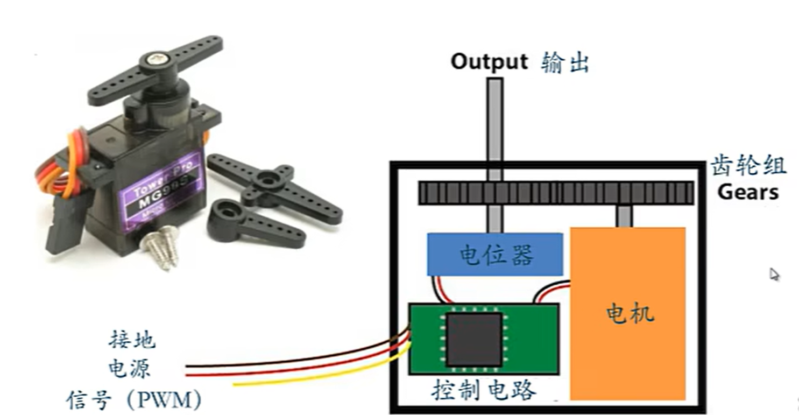

*舵机主要参数*

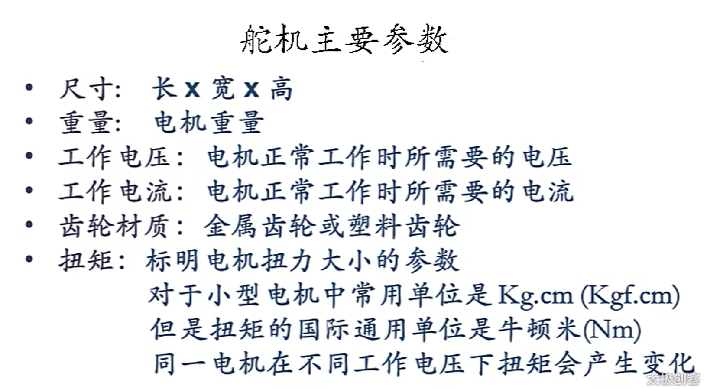

*#一般情况下，金属齿轮提供的扭矩比塑料齿轮大*

*arduino伺服电机电路连接参考*

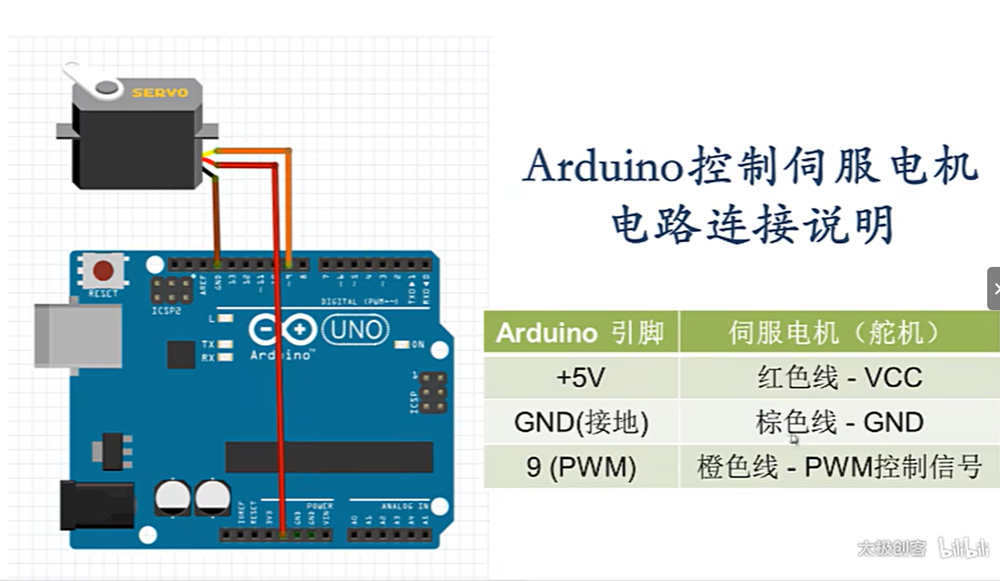

### 代码实现

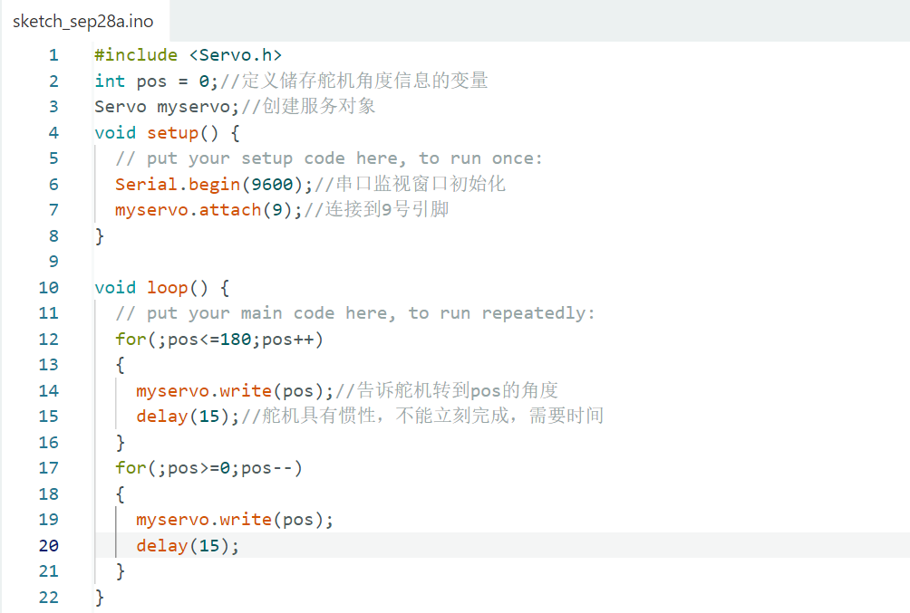

### Servo库

Servo库提供了许多函数，可供人创建服务对象，最多同时创建12个

**attach()**

**作用**:将代码中创建的 Servo 对象，与开发板上的一个具体引脚绑定起来。

*注：调用 attach() 时，Arduino 会自动帮你完成该引脚的初始化配置（如设置为输出模式），所以你通常不需要再手动写 pinMode()。*

**参数**

Pin

### 串行通讯1

串行端口用于Arduino板和其他设备进行通讯。个人电脑可以通过USB接口与Arduino的引脚0（RX）和引脚1（TX）进行通讯。当Arduino处于通讯状态时，引脚0和1不能做其他用途。

RX/TX工作时，相应的LED灯会亮起。

波特率：9600，每秒传输9600位(1字节8位)

### 串行通讯2

**串口接收缓存**：临时储存串口数据

**Serial.available()**
**作用**：告知Arduino查看是否有串口数据。串口接收数据缓存有x字节，就返回一个整型x。

**Serial.read()**
**作用**：按照先后顺序，一个一个读取Arduino缓存的数据，并以char类型的方式返回该数据（字节）。read()本身也可以读取舵机的信息（偏转角度）。

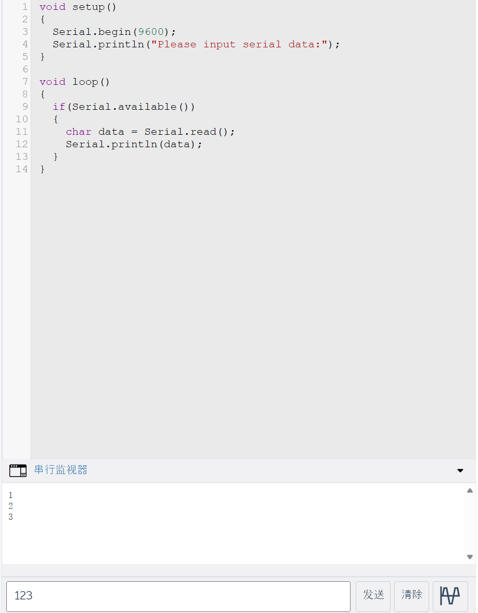

### 控制伺服电机

**面包板电源模块**

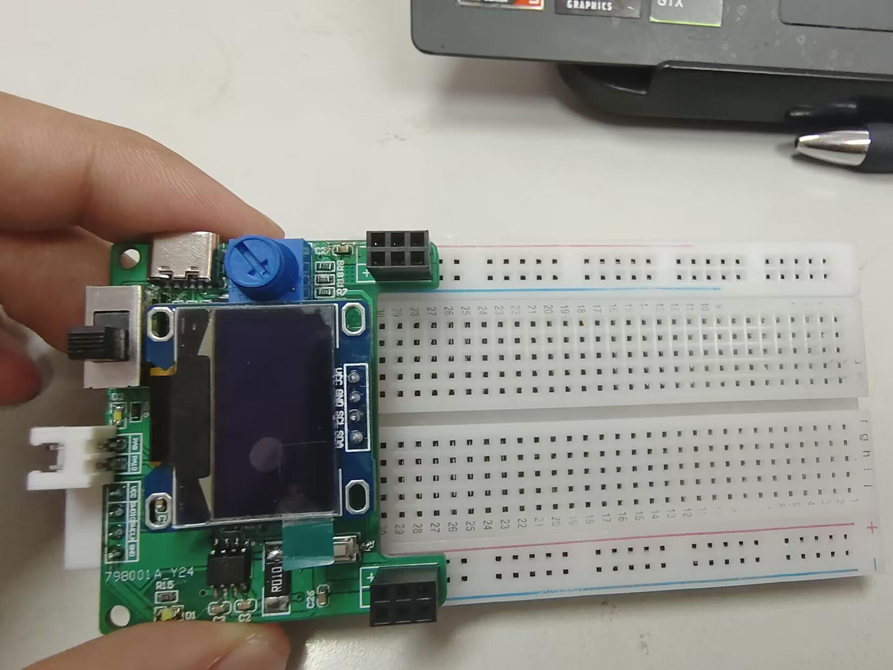

*注意：只需要插入一个电源即可！请确保在无电情况下连接电路！务必保证所有元件共地线*

**Serial.parseInt()**

**作用**：分析串口数据中的整型并将返回该值。

## 9.29

代码实现

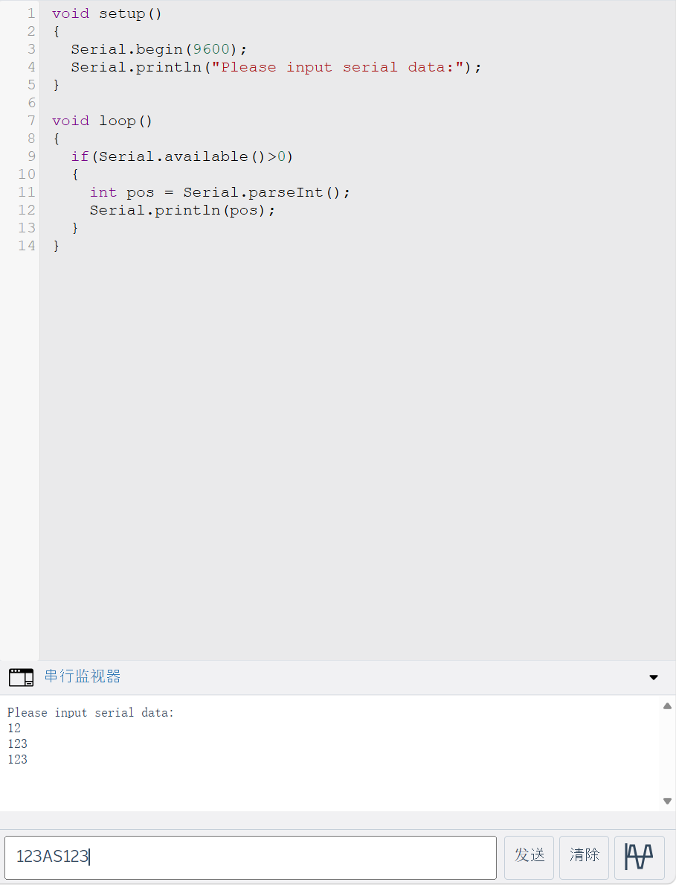

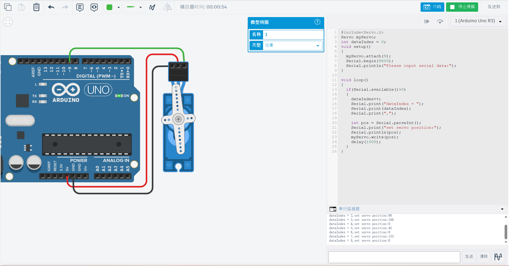

### 控制伺服电机2

控制4个伺服电机

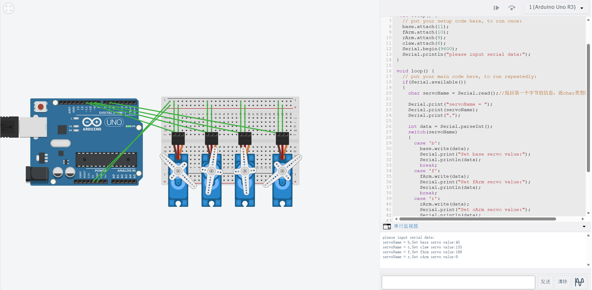

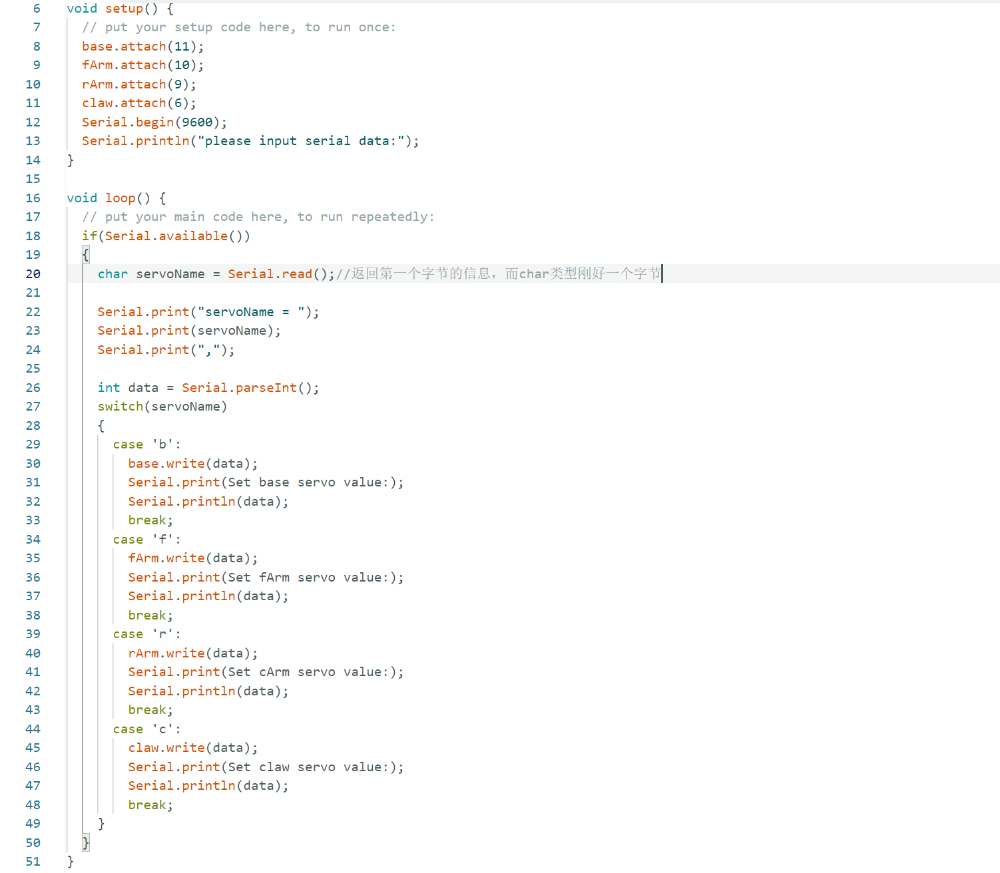

*注：tinkercad模拟真实电机，不能完全转到指定角度，是因为Arduino默认脉冲宽度比舵机实际需要的脉冲宽度要小，因此可以调节attach参数来避免这个问题，如attach(9,500,2500)。*

### 调试机械臂

使用机械臂时，务必要小心调试机械臂，找到四个舵机的调节范围，并使用const确保数据不会被更改。

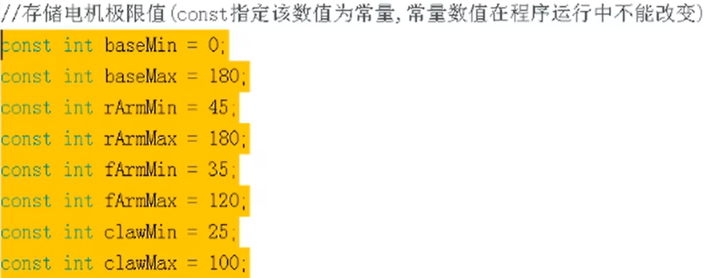

*注，上图数据可供参考。*

## 9.30

### 开发机械臂程序123

*代码展示*

```cpp
#include<Servo.h>//导入函数库

Servo base,fArm,rArm,claw;//创建四个对象（底座、小臂、大臂、钳子）

int basePos = 90;//设定舵机初始角度
int rArmPos = 90;
int fArmPos = 90;
int clawPos = 90;

const int baseMin = 0;//设置舵机旋转范围
const int baseMax = 180;
const int rArmMin = 45;
const int rArmMax = 180;
const int fArmMin = 35;
const int fArmMax = 120;
const int clawMin = 25;
const int clawMax = 100;

int DSD = 15;//default servo delay默认电机运动延迟时间

bool mode;//1，指令模式；0，手柄模式
int moveStep = 3;//没按下手柄按键，舵机移动量

void setup()
{
  base.attach(11);//连接舵机与引脚
  delay(200);//为初始化提供时间
  rArm.attach(10);
  delay(200);
  fArm.attach(9);
  delay(200);
  claw.attach(6);
  delay(200};

  base.write(90);//初始化舵机方向
  delay(10);
  claw.write(90);
  delay(10);
  rArm.write(90);
  delay(90);
  fArm.write(90);
  delay(10);

  Serial.begin(9600);//初始化串口监视窗口
  Serial.println("please imput serial data:");
}

void loop()
{
  if(Serial.available())//监测是否有串口数据输入
  {
    char serialCmd = Serial.read()//读取舵机名称
    if(mode == 1)
    {
      armDataCmd(serialCmd);//指令模式
    }
    else
    {
      armJoyCmd(serialCmd);//手柄模式
    }
  }
}

void armDataCmd(char serialCmd)//判断执行是否合法的函数
{
  if(serialCmd == 'w'||serialCmd == 's'||serialCmd == 'a'||serialCmd == 'd'
    ||serialCmd == '8'||serialCmd == '5'||serialCmd == '4'||serialCmd == '6')
  {
    Serial.println("+Warning:Robot in Instruction Mode...");
    delay(100);
    while(Serial.available()>0) char wrongCommand = Serial.read();
    return;
  }

  if(serialCmd == 'b'||serialCmd == 'c'||serialCmd == 'r'||serialCmd == 'f')//判断舵机是否存在
  {
    int servoData = Serial.parseInt();//读取串口数据
    servoCmd(serialCmd,servoData,DSD);//传递参数（舵机名，目标角度，延迟）
  }
  else
  {
    switch(serialCmd)
    {
      case 'm'://切换手柄模式
        mode = 0;
        Serial.println("Command:Switch to Joy-Stick Mode.");
        break;

      case 'o'://输出舵机状态信息
        reportStatus();
        break;
      case 'i':
        armIniPos();//重置舵机位置
        break;
      case 'p':
        playDice();
        break;
      default://非法命令
        Serial.println("Unknown Command.");
    }
  }
}

void armJoyCmd(char serialCmd)
{
  if(serialCmd == 'b'||serialCmd == 'c'||serialCmd == 'f'||serialCmd == 'r')
  {
    Serial.println("+Warning:Robot in Joy-Stick Mode...");
    delay(100);
    while(Serial.available()>0) char wrongCommand = Serial.read();
    return;
  }
  int baseJoyPos;
  int rArmJoyPos;
  int fArmJoyPos;
  int clawJoyPos;

  switch(serialCmd)
  {
    case 'a'://Base向左
      Serial.println("Recive Command:Base Turn Right");
      baseJoyPos = base.read() - moveStep;
      servoCmd('b',baseJoyPos,DSD);
      break;

    case 'd'://Base向右
      Serial.println("Recive Command:Base Turn Left");
      baseJoyPos = base.read() + moveStep;
      servoCmd('b',baseJoyPos,DSD);
      break;

    case 's'://rArm向下
      Serial.println("Recive Command:Rear Arm Down");
      rArmJoyPos = rArm.read() + moveStep;
      servoCmd('r',rArmJoyPos,DSD);
      break;
    
    case 'w'://rArm向上
      Serial.println("Recive Command:Rear Arm Up");
      rArmJoyPos = rArm.read() - moveStep;
      servoCmd('r',rArmJoyPos,DSD);
      break;
    
    case '8'://fArm向上
      Serial.println("Recive Command:Front Arm Up");
      fArmJoyPos = fArm.read() + moveStep;
      servoCmd('f',fArmJoyPos,DSD);
      break;

    case '5'://fArm向下
      Serial.println("Recive Command:Front Arm Down");
      fArmJoyPos = fArm.read() - moveStep;
      servoCmd('f',fArmJoyPos,DSD);
      break;

    case '4'://claw关闭
      Serial.println("Recieve Command:Claw Close Down");
      clawJoyPos = claw.read() + moveStep;
      servoCmd('c',clawJoyPos,DSD);
      break;

    case '6'://claw打开
      Serial.println("Recieve Command:Claw Open Up");
      clawJoyPos = claw.read() - moveStep;
      servoCmd('c',clawJoyPos,DSD);
      break;

    case 'm':
      mode = 1;
      Serial.println("Command:Switch to Instruction Mode.");
      break;

    case 'o':
      reportStatus();
      break;
    
    case 'i':
      armIniPos();
      break;
    
    default:
      Serial.println("Unknown Command.");
  }
}

void servoCmd(char servoName,int toPos,int servoDelay)
{
  Servo servotogo;//创建对象，方便控制

  //串口监视器输出接收指令信息
  Serial. println("");
  Serial. print ("+Command: Servo ");
  Serial. print (servoName) :
  Serial. print(" to");
  Serial. print (toPos);
  Serial. print(" at servoDelay value "):
  Serial. print (servoDelay)]
  Serial. println(".");
  Serial. println("");

  int fromPos;//储存电机初始运动角度值

  switch(servoName)
  {
    case 'b':
      if(toPos >= baseMin && toPos <= baseMax)//判断命令是否合法
      {
        servotogo = base;
        fromPos = base.read();//获取舵机当前角度值
        break;
      }
      else
      {
        Serial.println("+Warning:Base Servo Value Out Of Limit!");//非法命令
        return;
      }

    case 'c':
      if(toPos >= clawMin && toPos <= clawMax)
      {
        servotogo = claw;
        fromPos = claw.read();
        break;
      }
      else
      {
        Serial.println("+Warning:Claw Servo Value Out Of Limit!");
        return;
      }

    case 'r':
      if(toPos >= rArmMin && toPos <= rArmMax)
      {
        servotogo = rArm;
        fromPos = rArm.read();
        break;
      }
      else
      {
        Serial.println("+Warning:RArm Servo Value Out Of Limit!");
        return;
      }
    
    case 'f':
      if(toPos >= fArmMin && toPos <= fArmMax)
      {
        servotogo = fArm;
        fromPos = fArm.read();
        break;
      }
      else
      {
        Serial.println("+Warning:FArm Servo Value Out Of Limit!");
        return;
      }
  }

  if(fromPos <= toPos)//判断舵机转动方向
  {
    for(int i = fromPos;i <= toPos;i++)
    {
      servotogo.write(i);//转动舵机
      delay(servoDelay);
    }
  }
  else
  {
    for(int i=fromPos;i >= toPos;i--)
    {
      servotogo.write(i);
      delay(servoDelay);
    }
  }
}

void reportStatus()
{
  Serial. println(""):
  Serial. println("")
  Serial. println("+ Robot-Arm Status Report +");
  Serial. print("Claw Position: "); Serial. println(claw.read());
  Serial. print("Base Position: "); Serial. println (base.read());
  Serial. print ("Rear Arm Position:"); Serial. println(rArm.read());
  Serial. print ("Front Arm Position:"); Serial. println(fArm.read()):
  Serial.println("+++++++++++++++++++++++++++++++++++++++++++");
  Serial.println("");
}

void armIniPos ()
{
  Serial. println("+Command: Restore Initial Position.");

  int robotIniPosArray[4] [3] = {
  {'b', 90, DSD},
  {'r', 90, DSD},
  {'f', 90, DSD},
  {'c', 90, DSD}
  };

  for(int i=0;i<4;i++)
  {
    servoCmd(robotIniPosArray[i][0],robotIniPosArray[i][1],robotIniPosArray[i][2];
      delay(200);
  }
}

```

